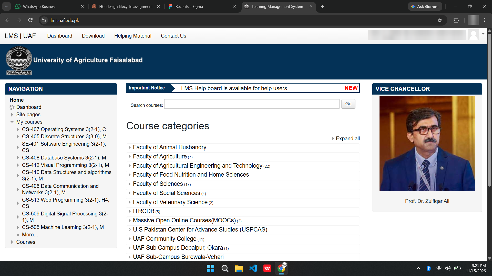
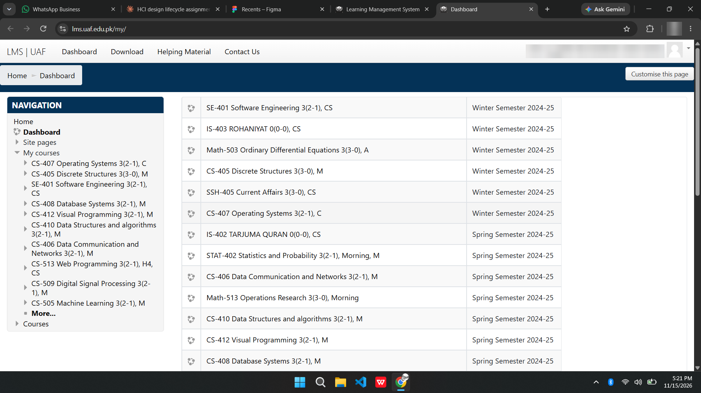
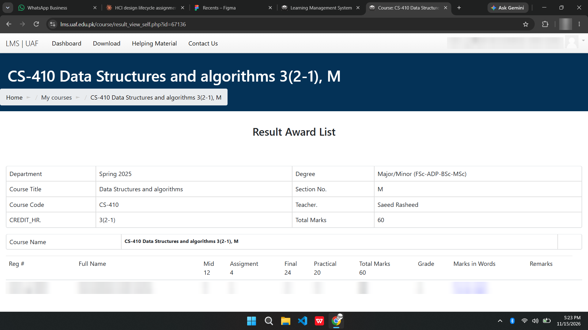

# HCI Design Portfolio

Wireframes, prototypes and usability evaluation reports for my Human-Computer Interaction (HCI) course, built week by week.

**Author:** Muhammad Asim Sadiq
**Tools:** Figma (design and prototyping), GitHub (version control and documentation)
**Figma file:** [View-only link](https://www.figma.com/design/w93viN79z7iNe9kmTyhKNY/Untitled?node-id=1-3&t=RjC5PHLOzpSvqNNz-1&code-node-id=1-3)

## Weekly Index

| Week | Topic | Deliverable |
|---|---|---|
| 1 | Intro to HCI and UX workflow | [Heuristic evaluation of the UAF LMS](week-01/evaluation-report.md) |

## Week 1 Preview

Evaluated flow: Login → Home → Dashboard → Course page → Result.

| Home after login | Dashboard (semesters mixed) | Result page |
|---|---|---|
|  |  |  |

Full findings, severity ratings and fixes are in the [evaluation report](week-01/evaluation-report.md).

## Repository Structure

```
hci-design-portfolio/
├── README.md
└── week-01/
    ├── evaluation-report.md
    ├── screenshots/
    └── wireframes/
```

## Method

Usability problems are found with **Nielsen's 10 heuristics** and rated on Nielsen's 0 to 4 severity scale. Each finding records the screen, the heuristic violated, the evidence and a suggested fix.

## Notes

Screenshots have personal information blurred before being committed.
